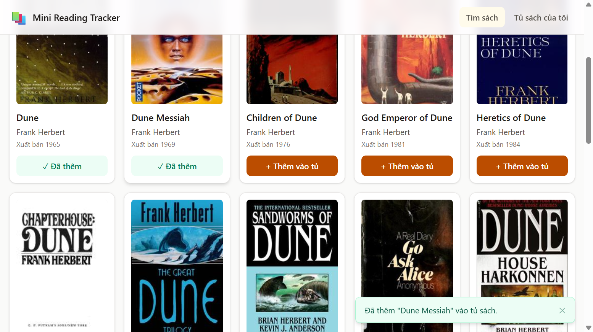
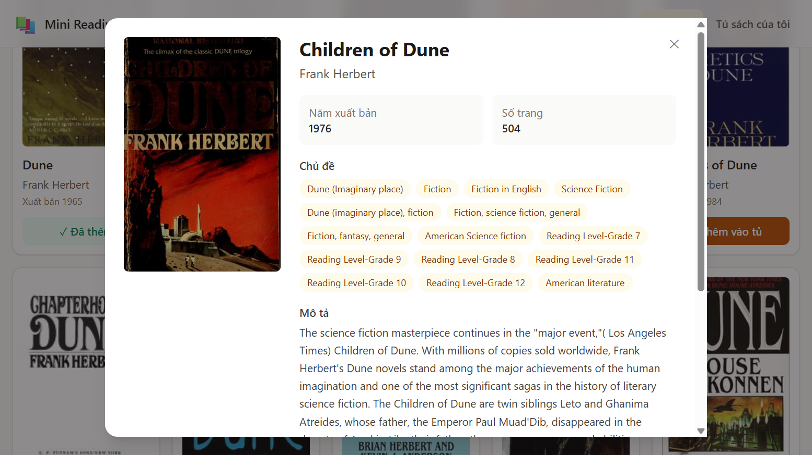
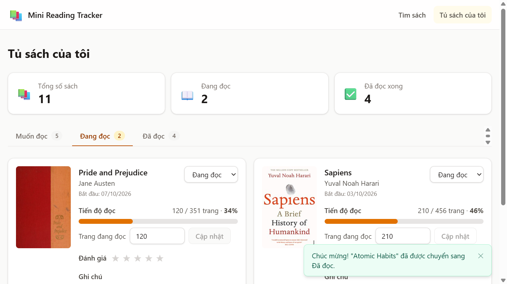
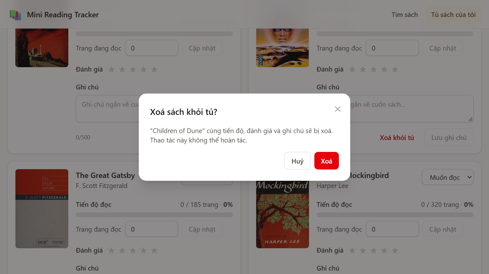
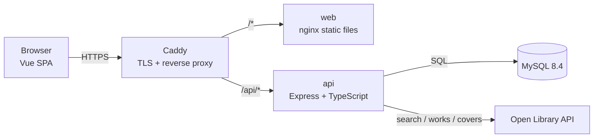
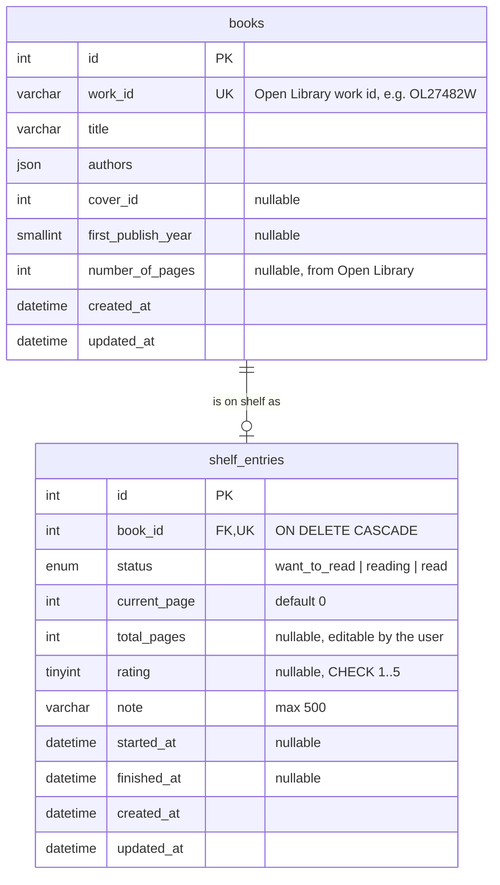

# 📚 Mini Reading Tracker

A small fullstack web app to **search books** (via the [Open Library](https://openlibrary.org/developers/api) public API),
keep them on a **personal bookshelf** and **track reading progress**. Single user, no login.

| Demo | URL |
| --- | --- |
| Frontend | `https://<your-domain>/` |
| Backend (API) | `https://<your-domain>/api` |
| API docs (Swagger) | `https://<your-domain>/api/docs` |

> Replace `<your-domain>` with the deployed domain after deployment.

## Screenshots

| Search | Book detail |
| --- | --- |
|  |  |

| My bookshelf | Remove confirmation |
| --- | --- |
|  |  |

## Features

**1. Search (home)** — search by title or author, result grid (cover, title, authors, first publish year),
pagination, `+ Add to shelf` button or `Added` badge, loading / empty / error states. The query and page live in
the URL (`/?q=dune&page=2`) and typing is debounced.

**2. Book detail** — modal opened from any screen via `?book=<workId>` (shareable link, closes with Esc or the back
button): cover, title, authors, description, page count, subjects, first publish year; add to the shelf with an
initial status (Want to read / Reading / Read).

**3. My bookshelf** — tabs per status, quick stats (total, reading, finished), and per book: progress bar
(current page / total pages), current page update, status change, 1–5 star rating, short note, remove with
confirmation.

### Business rules (enforced in the backend)

| Rule | Implementation |
| --- | --- |
| No duplicate books on the shelf | `409 Conflict` — checked in the service and guaranteed by a `UNIQUE` key |
| `0 ≤ currentPage ≤ totalPages` | zod schema + domain rule + DB `CHECK` constraint |
| Rating is an integer 1–5 or empty | zod schema + DB `CHECK` constraint |
| Last page reached → status becomes **Read** | `applyReadingChange()` in `api/src/modules/shelf/shelf.rules.ts` |
| First switch to **Reading** records the start date; switch to **Read** records the finish date | same function, unit-tested |
| Validated input, uniform error format | `{ "error": { "code", "message", "details"?: [{ "field", "message" }] } }` |

## Tech stack

| Layer | Technology |
| --- | --- |
| Frontend | Vue 3, TypeScript, Vite, Vue Router, Pinia, vue-i18n, Tailwind CSS v4, axios |
| Backend | Node.js 22, Express 5, TypeScript, zod, Knex (migrations), mysql2, pino, helmet, express-rate-limit, Swagger UI |
| Database | MySQL 8.4 |
| Tests | Vitest + Supertest (unit + HTTP integration) |
| Deployment | Docker Compose on a VPS, Caddy (automatic HTTPS), nginx (static files), GitHub Actions CI |

## Architecture



- The browser **never calls Open Library directly**; search, detail and **cover images** go through the backend
  (`/api/covers/:id` is an image proxy with cache headers).
- The backend is layered per module: `routes` (HTTP + zod validation) → `service` (use cases) → `rules` (pure business
  rules) / `repository` (Knex SQL). Dependencies are injected in `server.ts`, so tests swap MySQL and Open Library for
  in-memory fakes.
- Open Library calls have a timeout, retry with exponential backoff on network errors / 429 / 5xx, and an in-memory LRU
  cache (search 10 min, works 1 h, covers 24 h).
- The book metadata stored with a shelf entry is always fetched by the server from Open Library, never trusted from
  the client.
- All user-facing text lives in `web/src/locales/vi.json`; the code itself only contains English.

### Project structure

```
api/                     Express API
  src/config/            env validation (zod)
  src/db/                knex instance, migrations, sample-data seed
  src/modules/books/     search, detail, cover proxy
  src/modules/shelf/     shelf rules, repository, service, routes
  src/modules/open-library/  HTTP client (timeout, retry, cache)
  tests/                 unit + integration tests
  openapi.yaml           API specification (served at /api/docs)
web/                     Vue SPA
  src/api/               typed API client
  src/stores/            Pinia stores (shelf, toast)
  src/components/        UI components
  src/views/             Search, Shelf, NotFound
  src/locales/vi.json    UI text
docker-compose.yml       production stack (mysql, api, web, caddy)
docker-compose.dev.yml   MySQL only, for local development
Caddyfile                HTTPS + routing
scripts/                 deploy and database backup
```

## Database



- `books` is a snapshot of Open Library metadata; `shelf_entries` is the user's reading state. A unique `book_id`
  makes "one entry per book" a database guarantee.
- `total_pages` lives on the entry because Open Library often has no page count; the user can then fill it in.
- `CHECK` constraints mirror the API rules (rating range, `current_page <= total_pages`).
- All `DATETIME` values are stored in UTC.

## API

Base path `/api`. Full specification: [`api/openapi.yaml`](api/openapi.yaml) or Swagger UI at `/api/docs`.

| Method | Path | Description |
| --- | --- | --- |
| GET | `/health` | Liveness + database check |
| GET | `/books/search?q=&page=` | Search (20 per page) with an `inShelf` flag per result |
| GET | `/books/:workId` | Book detail (+ `shelfEntry` when it is on the shelf) |
| GET | `/covers/:coverId?size=S\|M\|L` | Cover image proxy |
| GET | `/shelf?status=` | Shelf entries, optionally filtered by status |
| GET | `/shelf/stats` | `{ total, want_to_read, reading, read }` |
| POST | `/shelf` | Add `{ workId, status?, totalPages? }` → `201`, or `409` if already on the shelf |
| PATCH | `/shelf/:id` | Update any of `{ status, currentPage, totalPages, rating, note }` |
| DELETE | `/shelf/:id` | Remove → `204` |

Error codes: `VALIDATION_ERROR` (400), `NOT_FOUND` (404), `CONFLICT` (409), `RATE_LIMITED` (429),
`INTERNAL_ERROR` (500), `UPSTREAM_ERROR` (502, Open Library unavailable).

Example:

```bash
curl -X PATCH https://<your-domain>/api/shelf/1 \
  -H 'Content-Type: application/json' -d '{"currentPage": 999}'
# 400 {"error":{"code":"VALIDATION_ERROR","message":"Current page must be between 0 and 310",
#      "details":[{"field":"currentPage","message":"Must be less than or equal to total pages (310)"}]}}
```

## Running locally

Requirements: Node.js ≥ 20.19, Docker.

```bash
# 1. Database
docker compose -f docker-compose.dev.yml up -d

# 2. API (http://localhost:3000, docs at /api/docs)
cd api
cp .env.example .env        # defaults match docker-compose.dev.yml
npm install
npm run dev                 # runs migrations and seeds sample data on start

# 3. Web app (http://localhost:5173, proxies /api to the API)
cd ../web
npm install
npm run dev
```

Quality checks:

```bash
cd api && npm run lint && npm run typecheck && npm test && npm run build
cd web && npm run lint && npm run build      # build includes vue-tsc type-check
```

Or run the whole production stack locally over plain HTTP:

```bash
cp .env.example .env   # set SITE_ADDRESS=:80 and passwords
docker compose up -d --build
# open http://localhost
```

## Deployment (VPS + Docker Compose)

The whole app runs on a single Ubuntu VPS: `mysql`, `api`, `web` and `caddy` containers. Only Caddy publishes ports
(80/443); MySQL and the API are reachable only on the internal Docker network. Caddy obtains and renews a Let's
Encrypt certificate automatically and redirects HTTP to HTTPS.

1. **DNS** — create an `A` record for your domain pointing to the VPS IP.
2. **Install Docker** on the VPS:
   ```bash
   curl -fsSL https://get.docker.com | sh
   sudo usermod -aG docker $USER   # log out and back in
   ```
3. **Firewall** — allow only SSH and web traffic:
   ```bash
   sudo ufw allow OpenSSH && sudo ufw allow 80/tcp && sudo ufw allow 443/tcp && sudo ufw allow 443/udp
   sudo ufw enable
   ```
4. **Code and configuration**:
   ```bash
   sudo mkdir -p /opt/reading-tracker && sudo chown $USER /opt/reading-tracker
   git clone https://github.com/tuanmoccs/open_lib.git /opt/reading-tracker
   cd /opt/reading-tracker
   cp .env.example .env
   nano .env   # SITE_ADDRESS=<your-domain>, strong MYSQL_ROOT_PASSWORD / MYSQL_PASSWORD
   chmod 600 .env
   ```
5. **Start**:
   ```bash
   docker compose up -d --build
   docker compose ps          # all services should become healthy
   ```
   On the first start the API runs the migrations and inserts sample data (only when the shelf is empty).
6. **Updates**: `./scripts/deploy.sh` (git pull + rebuild + health check).
7. **Backups** (optional, recommended): daily dump at 03:00, keeps the last 7 files in `backups/`:
   ```bash
   (crontab -l 2>/dev/null; echo "0 3 * * * /opt/reading-tracker/scripts/backup-db.sh >> /opt/reading-tracker/backups/backup.log 2>&1") | crontab -
   ```

Stability: every container has `restart: unless-stopped` (and Docker starts on boot), health checks, and log rotation
(10 MB × 3 per container) so the disk does not fill up during unattended operation.

Secrets: credentials exist only in the server's `.env` (git-ignored); `.env.example` files contain placeholders only.

## Assumptions and decisions

- **Page count**: `works/{id}.json` has no page count, so the API uses `number_of_pages_median` from the Open Library
  search index. When it is missing, the user enters the total pages (when adding, or later on the shelf); page
  tracking is disabled until then.
- **Cover images are proxied** by the backend too, to strictly follow "the frontend never calls Open Library".
- **Status transitions** (beyond the stated rules):
  - adding a book directly as *Read* sets the finish date and the current page to the last page;
  - switching to *Read* moves the current page to the last page;
  - logging a page below the total without choosing a status moves the book to *Reading* (from *Want to read* or
    *Read*);
  - switching from *Read* back to *Reading* clears the finish date and restarts at page 0; the original start date is
    kept;
  - leaving *Read* clears the finish date.
- **Sample data** (9 real books across all statuses) is inserted on start only when the shelf is empty. If a reviewer
  removes every book, the sample data comes back on the next restart; set `RUN_SEED=false` to disable.
- The shelf list is not paginated (single user, small data set).
- Public endpoints have no authentication (as required); a per-IP rate limit protects the Open Library proxy.

## Limitations and possible improvements

- Concurrent updates of the same entry are last-write-wins (no optimistic locking); fine for a single user.
- The Open Library cache is in-memory per process; Redis would be needed for multiple API instances.
- The search page is limited to 100 pages (Open Library deep pagination is slow).
- No frontend unit / end-to-end tests yet (the UI was checked manually in the browser); Playwright tests for the
  three screens would be the next step.
- Possible features: user accounts, reading history / statistics over time, sorting and search inside the shelf,
  English UI (the i18n setup already supports adding `en.json`).
